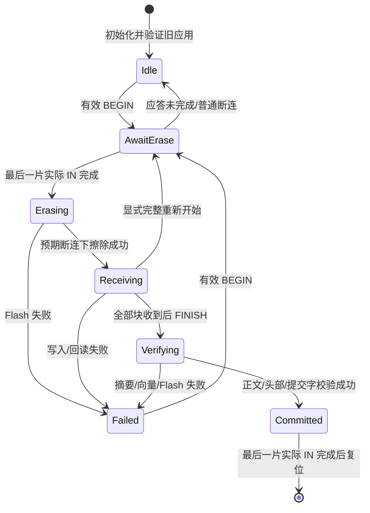
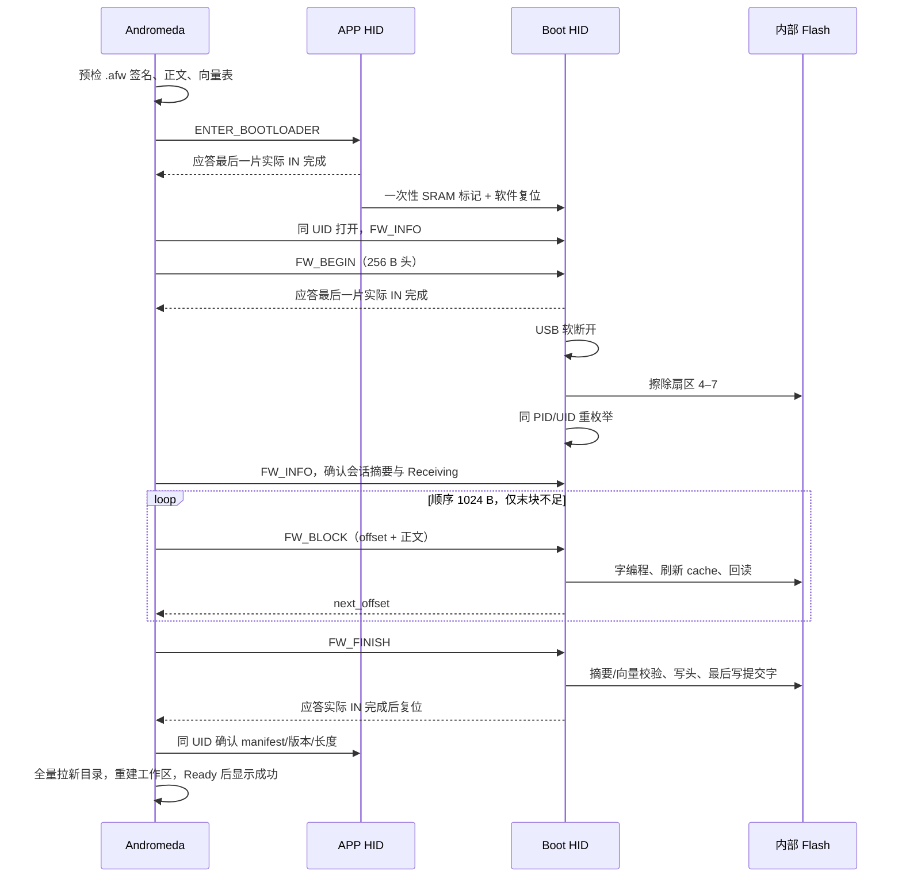

# USB Bootloader 与 MCU 固件升级设计

本实现面向 STM32F446VET6，使用独立 HID Bootloader 和签名 `.afw` 包更新内部 Flash；Andromeda 复用“工具 → 更新”。软件实现、签名实板升级及关闭/进程中断恢复已通过相应范围验收；量产配置、完整中断矩阵和真实业务维护条件仍待验证。线级字段、服务码和错误码以 [PROTOCOL.md](PROTOCOL.md) 为真源；硬件与密码库依据见 [BOOTLOADER_RESEARCH.md](https://github.com/f1rstzi0n/USB-HID/blob/usb-hid-archive-20261012/docs/BOOTLOADER_RESEARCH.md)。

## 分区、签名头与启动

| 区域 | 地址 | 大小 |
|---|---|---:|
| Boot，扇区 0–3 | `0x08000000–0x0800FFFF` | 65,536 B |
| 应用校验区 | `0x08010000–0x080101FF` | 512 B |
| 应用及向量表 | `0x08010200–0x0807FFFF` | 458,240 B |

应用校验区的实际用途如下；“签名头区域”并不代表 512 B 都是签名。

```text
0x08010000  +0    ┌────────────────────────────────────┐
                 │ 192 B 元数据：格式/目标/地址/长度/  │
                 │ 版本/应用 SHA-256/Boot 契约/保留零   │
0x080100C0  +192  ├────────────────────────────────────┤
                 │ 64 B P-256 签名：大端 r || s         │
0x08010100  +256  ├────────────────────────────────────┤
                 │ 252 B 对齐填充，保持擦除值 0xFF     │
0x080101FC  +508  ├────────────────────────────────────┤
                 │ 4 B 提交字 0xA55AC33C，最后写入     │
0x08010200  +512  └────────────────────────────────────┘
                 应用向量表与连续正文，512 B 对齐
```

`.afw` 仅包含 256 B 签名头和实际正文，不含对齐填充、提交字、ZIP 或额外尾部数据。签名验证 SHA-256(头部前 192 B)，头部的应用摘要约束完整正文。头中的目标必须为 `BV500-F446`，加载地址、Boot 契约、长度、ASCII 版本及保留零均严格检查。设备信任编译进 Boot 的固定公钥；包不能提供替代公钥，也不携带私钥。

每次上电或复位先验证提交字、头部签名、完整正文摘要和向量表。初始 SP 必须 8 B 对齐且位于 `0x20000000` 以上至 `0x2001FFF8`；ResetHandler 必须带 Thumb 位且落在实际正文内。有效应用直接启动；无效或未完成镜像留在 Boot，不增加救援等待窗口。已合法签名但运行卡死的应用通过 SWD 维修。

APP linker 将 Flash 起点设为 `0x08010200`，`SystemInit` 同步设置 VTOR；Boot 的 Flash 起点保持 `0x08000000`。两个 linker 都为 SRAM 顶部 `0x2001FFF8–0x2001FFFF` 保留 8 B `.boot_request (NOLOAD)`，不进入 BSS 清零或普通栈。APP 进入 Boot 的请求写入 `0xB007F446` 及其反码，仅在软件复位、无 POR/BOR 且两字匹配时接受；Boot 消费后立即清除标记与复位状态。上电、掉电、棕断或随机 SRAM 内容均不作为主动进入 Boot 的依据。

## Module、adapter 与调用顺序

`src/boot/fw_update.{h,c}` 是升级 module，集中实现验证、固定地址限制、状态、提交及 FW_INFO；其 Flash seam 有板级 HAL adapter 与断电 Fake adapter 两个实现。`firmware/fw_platform.c` 负责实际 Flash、USB 断连、复位标记和跳转；`src/usb/usb_proto.c` 复用既有分片、帧、CRC16 与单事务引擎。

- **启动**：`fw_update_init(io, public_key, uid)` 回读并验证应用，缓存有效头部、manifest hash 和版本；APP 使用只读 adapter，Boot 另提供字编程与扇区擦除。UID 为三个芯片 UID word 的小端字节，并生成 APP/BOOT 共用序列号。
- **APP 进入 Boot**：`fw_platform_app_init(check)` 注册共享服务 backend。ENTER_BOOTLOADER 必须通过业务维护检查，且不能正在光盘更新；检查未绑定时拒绝。Fake 明确绑定其无执行机构动作的实现。最后一片实际 IN 完成后，主循环软断开 USB、写一次性标记并软件复位。
- **BEGIN**：`fw_update_request()` 先验证 256 B 头部，只进入 AwaitErase，不擦 Flash。协议引擎在最后一片实际 IN 完成时调用 `reply_complete(svc,true)`，经 `fw_update_tx_complete()` 产生 ERASE action。发送失败、看门狗或未完成发送时断连撤销待擦除动作。
- **擦除**：board 的 `fw_platform_task()` 取 ERASE action，标记预期断连、软断开并清理通信状态，等待 250 ms，调用 `fw_update_erase()` 同步擦扇区 4–7。然后重新初始化协议引擎、等待 250 ms，以相同 Boot PID/UID 重连。成功进入 Receiving，失败留在 Boot 并报告 Flash 错误。
- **BLOCK**：按精确 next_offset 顺序写 1024 B，仅末块可不足；不足一个 word 填 `0xFF`。HAL adapter 逐 word 编程并服务 TinyUSB，完成后刷新 Flash cache；module 回读比较后才推进偏移并应答。协议引擎保护 dispatch 生命周期，断连/总线复位后不发送旧连接应答，也不让 dispatch 中的新 OUT 覆盖正在处理的请求。
- **FINISH**：回读整个正文并核对实际长度摘要、向量表，写入并回读 256 B 签名头，最后单独编程并回读提交字。只有最后一片应答实际 IN 完成才产生 RESET action。提交已完成但应答丢失时，FW_INFO 仍可提供已提交镜像证据。

读/写、擦除 adapter 均限制在应用区；USB 永远不修改 Boot、公钥、Option Bytes、EEPROM、校准区或 W25Q64。实际 Flash 擦写的供电和 parallelism 条件由 adapter 与制造配置满足，不能由纯 host 测试证明。



普通 USB 断连或迟到 unmount 不丢弃 Receiving/Committed 会话；MCU 复位或断电会丢弃 RAM 会话，重新开始必须从 BEGIN 整包刷写。单槽直接更新不保留上一份应用；中断后 Boot 提供重刷入口。提交字写到一半不能启动；若掉电发生在完整提交字已写成之后，重启仍须验证整个签名应用才能启动。



## Andromeda 工作流与恢复

MCU 能力位为 **`0x0004`**；现有 `0x0002` 已用于持久化能力，因此未复用原计划中的占用位。APP/BOOT 身份增加模式，但原 APP 默认打开行为保持兼容。

配套 `AndromedaFirmwarePackage` 与 `AndromedaFirmwareUpdater` module 共用固定包格式，使用 .NET Framework SHA-256/ECDsaCng。协议写事务不自动重发；读超时 200 ms、最多重试一次，BEGIN/BLOCK 2 秒、FINISH 15 秒，擦除重连最多 30 秒。丢 BLOCK 应答仅凭同 UID、同会话摘要和已推进偏移继续；提交结果无法确认时保留 PendingConfirmation。设备不存在或 UID 重复不自动挑另一台。

现有 UpdateViewModel/UpdateService/Report/Summary 接入单个 `.afw`，`.aky` 光盘更新沿用其流程；选文件先验签再接管设备。更新期间拒绝更新窗口及其所有者的正常关闭请求，新工作区确认和摘要期间也保持保护，关闭请求不停止传输、不弹阻塞提示。PreparingBegin 阶段同步禁用取消。发送 BEGIN 前的取消可通过 RUN_APP 回到原有效应用；返回未确认则报告待确认。开始升级后不自动恢复旧目录，释放原升级 scope 也不会重新启用旧工作区。

传输中进程意外退出视为本次升级失败；未提交应用保持 Boot，重新启动后从 BEGIN 整包恢复。原生 USB 的升级占用使用按 UID 命名的内核句柄并保留嵌套计数，进程退出自动释放，避免旧兼容进程使遗留文件锁隐藏恢复设备。实板关闭、强制结束及恢复证据见 [验收记录](https://github.com/f1rstzi0n/USB-HID/blob/usb-hid-archive-20261012/docs/validation/ANDROMEDA-MCU-CLOSE-20261010.md)。

仅发现 Boot 的启动连接直接打开原更新窗口的恢复模式，不拉参数目录。设备层确认目标签名镜像后，UI 新建 manager、完整拉目录并初始化，Ready 且设备版本与签名版本一致才报告成功；关闭 Summary 后提交新工作区并释放旧 manager。PendingConfirmation 的复核先刷新原 UID 当前模式，再确认镜像及重新初始化。

新版本的 EEPROM/校准数据兼容性必须在发布前验证。升级器不自动迁移、保存或恢复持久化参数；不能把新固件的业务兼容性推断为“Flash 写入成功”。合法旧版本允许回退，相同包允许重复刷写。

## 发布、首装与 SWD 维护

1. 在离线 Windows CNG 环境准备既有 AURASKY P-256 发布密钥；不在仓库、设备、安装包或本轮工具流程中生成/导出生产私钥。
2. 构建 `tools/firmware/Andromeda.FirmwarePack.csproj`；通过 `--key AURASKY_RELEASE_KEY --export-public <目录>` 导出 64 B 公钥、`fw_public_key.h` 与 `FirmwareSigningKey.cs`，将同一公钥安装到 Boot/APP 和配套通信库并重新构建。全零公钥拒绝全部签名包和应用启动；2026-10-09 已配置 AURASKY_RELEASE_KEY 对应发布公钥，当前构建与实板状态见 [验收记录](https://github.com/f1rstzi0n/USB-HID/blob/usb-hid-archive-20261012/docs/BOOTLOADER_VALIDATION.md)。
3. 根 CubeIDE 的 Debug/Release 构建 APP，BootDebug/BootRelease 构建 Boot；Boot 使用 `-Os`，linker 64 KiB 上限必须通过。CubeMX 再生成后执行 source 恢复与 generated 检查；检查覆盖 APP/BOOT linker 与 VTOR，不另建第二套固件构建定义。
4. 发布工具用应用 `.bin`、ASCII 版本和受限 Boot `.hex` 生成 `.afw`、`.signed-app.hex`、`.factory.hex`。工具验证分区、向量、摘要和签名，但无法证明输入 Boot 内嵌对应公钥；制造必须核对同一导出公钥、Boot 构建来源与目标板。具体命令见 [发布工具说明](https://github.com/f1rstzi0n/USB-HID/blob/usb-hid-archive-20261012/tools/firmware/README.md)。
5. 首装通过 SWD 写入 `.factory.hex` 并校验。制造配置 **WRP 扇区 0–3、RDP0**，保留 SWD；不通过 USB 设置 Option Bytes，也不进行默认全芯片擦除。签名 APP HEX 仅用于已装正确 Boot 的 SWD 维护。裸 APP `.hex` 或旧地址应用不能替代签名工厂镜像。
6. 更新 Boot 或信任公钥仅通过 SWD；由维修流程核对/调整 Boot 的写保护，重建并写入匹配公钥的 Boot 与签名应用，然后恢复扇区 0–3 保护。RDP0 是保留维修能力的既定选择，签名保护 USB 更新来源，不承诺抵抗持有 SWD 的物理修改。

## 软件证据与待实板验收

2026-10-09 四个 CubeIDE 配置均构建通过，0 errors / 0 warnings；最终缓存刷新/BOR 变更后四配置已重构建，日志为 `.scratch/mcu-upgrade/cube-verified.log`。

| 配置 | BIN 字节数 | 分区上限 |
|---|---:|---:|
| BootDebug / BootRelease | 37,380 | 65,536 |
| APP Debug | 378,924 | 458,240 |
| APP Release | 318,840 | 458,240 |

- `boot_update` 使用真实 Mbed TLS 3.6.6 和真实升级 module：6 组场景、45 种擦除/块/头/提交断电注入均通过；最大容量、零公钥、坏签名、坏摘要、坏向量、实际 IN gate、回读失败、重复刷写和断连保持均覆盖。
- `boot_usb` 编译真实 Boot 描述符，3 组场景通过：独立 PID、单 HID、64 B 中断双端点、无 MSC、报表位数和 UID 序列号。`usb_proto` 增加最终实际 IN 完成、断线/watchdog、dispatch 中断连及新请求恢复的回归。
- Andromeda 协议相关 Hardware filter **3/3 通过**，覆盖 APP/BOOT 起始、BEGIN/BLOCK/FINISH 丢应答且写入次数不增加、只读确认、错 UID、早期取消返回有效 APP 和已提交 Boot 待确认。
- 固定 `.afw` 测试包与公钥为 C/C# 共享，测试正文不能上板执行，测试私钥未保存。发布工具构建与 `--self-test` 通过，覆盖包加载、签名/摘要/目标/向量及 HEX 分区读回检查。
- 原生 host 合并回归 **15/15 通过**，记录为 `.scratch/mcu-upgrade/host-final.log`（原最终集成回归，15 Passed / 0 Failed）。AndromedaUsbTreeTests 完整 class **3/3 通过**；Update 项目构建 0 errors / 0 warnings，locale validate/generate 无错误或警告，locale check 保留既有 unused 提示。

2026-10-10 已完成 SWD 首装、签名拒绝零擦写、正常/重复升级、软件复位中断恢复、Flash/光盘摘要核对，见 [Boot 实板验收](https://github.com/f1rstzi0n/USB-HID/blob/usb-hid-archive-20261012/docs/BOOTLOADER_VALIDATION.md)。实际 Andromeda 正常界面及关闭/进程中断恢复亦已通过，见 [界面验收](https://github.com/f1rstzi0n/USB-HID/blob/usb-hid-archive-20261012/docs/validation/ANDROMEDA-MCU-UI-20261010.md)、[关闭保护验收](https://github.com/f1rstzi0n/USB-HID/blob/usb-hid-archive-20261012/docs/validation/ANDROMEDA-MCU-CLOSE-20261010.md)。

现场须停机隔离，以下事项仍待验收：

- [ ] 量产 WRP 扇区 0–3、BOR 配置及 Boot/公钥 SWD 维修流程。
- [ ] 真实丢应答恢复、跨版本回退、目标/容量拒绝，以及提前取消返回原 APP。
- [ ] 擦除、正文、签名头、提交阶段的物理断电/拔线完整矩阵。
- [ ] EEPROM/校准保持、目标业务固件持久化兼容性及真实执行机构安全初态。
- [ ] 真实动作/学习/保存/其他更新期间的维护检查和进入 Boot 拒绝。

任务状态见 [MCU 升级实施单](https://github.com/f1rstzi0n/USB-HID/blob/usb-hid-archive-20261012/.scratch/cpa4-usb-gap/issues/08-mcu-upgrade.md)：上述制造与真实业务验收为 `ready-for-human`。
