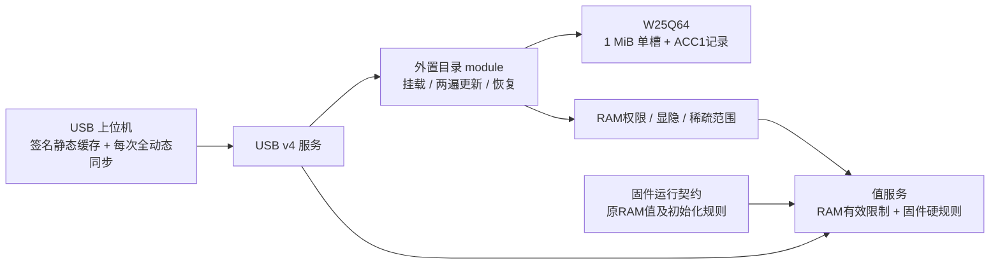

# USB 参数目录外置设计

日期：2026-10-10。实现与软件验收见 [本轮验收记录](https://github.com/f1rstzi0n/USB-HID/blob/usb-hid-archive-20261012/docs/validation/USB-CATALOG-20261010.md)，字节契约见 [协议§7.14/§8.2](PROTOCOL.md#714-外部参数目录0x300x36)，官方依据见 [研究记录](https://github.com/f1rstzi0n/USB-HID/blob/usb-hid-archive-20261012/docs/USB-CATALOG-RESEARCH.md)。

## 已落实的设计

外置目录模块把包验证、读取、更新和恢复集中在同一个 interface 后面。Flash seam 复用光盘现有read/erase/program/poll/reserve约定，生产W25Q64 adapter与可注入掉电的NOR adapter穿过同一interface验证。USB服务只做路由，值服务只查询RAM中的已验证限制。删除目录模块会把验签、分区检查、提交和恢复重新散到各caller，故保留这个deep module。

只迭代自研USB。Andromeda的RS485报文、目录加载、读写、保存、轮询与恢复行为保持既有基线；USB限制挂在独立context，不能修改串口共享profile。

## 存储与运行规则

| 内容 | 所在位置 |
|---|---|
| 名称、树、枚举、单位、显示属性、默认描述、主窗口绑定、错误文案 | 1MiB目录槽的签名ACAT包 |
| 地址、类型、元素数、实际执行尺寸、硬权限/范围、RAM值位置 | MCU内部Flash的按地址排序32B运行记录 |
| 原初始化字节 | MCU程序的数据初始化段；不由目录包写入 |
| 动态权限/范围/visible/pending | 运行状态与已验证目录限制的交集 |
| 恢复诊断的少量通用错误文本 | MCU保留tiny fallback，坏目录时仍可诊断 |

保持光盘0x000000–0x3FFFFF及BVC4记录0x7F0000/0x7F1000不变。目录0x400000–0x4FFFFF；ACC1记录0x7F2000/0x7F3000，各4KiB；剩余48KiB管理区保留。外部MCU区仍仅预留。

完整静态包为123104B，PARAM/TREE/UI/INDEX/ERR五段。4B偏移索引避免重复长度字段与全量RAM索引。设备最多2300参数、单记录3500B、64条不同于硬范围的稀疏范围限制；超过上限完整预检零擦写拒绝。字符串唯一性采用有界64位指纹表，TREE阶段与UI阶段复用；碰撞保守拒绝合法包，禁止因碰撞放过重复项。

Default仅是描述，不改变RAM初值或当前值。冻结来源中Reset、MACAddress、ZeroConstant、ValveType和两个CurrentSetpoint参数的既有默认描述在当前写范围外，全部保留；长度与finite校验仍执行，实际写入严格执行当前硬范围和USB限制。

## Ready 与更新

- 冷连接：HELLO→INFO→完整签名静态包→同一修订全动态快照→主窗口成员及必要初值→Ready。静态整包已有UI绑定，无需重复上传树/属性。
- 缓存连接：核实UID、设备/app身份、格式/schema/runtime/body摘要及缓存签名；每次重新获取完整动态快照和初值。缓存坏包或身份不符重新完整读取。
- 主窗口仅选择/排序现有29个语义role及既有业务地址，沿用现有按钮工作流、单位换算和图表。不增加脚本或任意页面。
- 更新第一遍完整结构、运行兼容性、SHA-256及目录专用域P-256签名预检，零擦写。第二遍绑定同一头、长度及摘要，先提交并回读无效记录，随写随擦单槽；完整回读和限制准备通过，最后写有效提交标志。
- 目录更新和光盘更新共用维护owner，不能并发。维护期间暂停普通参数操作及业务动作。
- 丢写应答只用INFO查询，不自动重发。有效提交应答实际IN完成后软重枚举；未完成IN由主机查询并主动重建工作区。新工作区必须同UID、目标摘要和完整Ready，设备RAM/pending保留，界面草稿丢弃。
- 单槽更新中断没有旧目录回滚，可能只能整包重刷。正常运行缺目录时固件按自身业务规则运行，USB保留诊断及恢复入口。

## 启动与验收

HID初始化前只探测Flash、初始化上下文并排队校验，不同步读取整盘。主循环先处理完整前台HID请求，目录验证先于光盘CRC，每次后台读取总量≤256B；签名验证用restartable P-256预算64。光盘须全文CRC通过才挂载。

目标：冷Ready≤3s、缓存Ready≤1s（HID句柄打开到完整Ready）；正常读取P95≤20ms、写入加独立读回≤40ms；分别记录上电到HID可用时间。基线Release ROM271504B、静态RAM48320B，目标净减ROM≥100KiB、峰值RAM≤112KiB。传输预算、native测试、链接静态占用均不能替代实板墙钟和RAM峰值证据。
